:::caution
These docs are under construction.

TODO:

* Write documentation for creating a .msg file and all messages/sels within
* Write documentation for editing a .msg via hooking
* Write documentation for creating/editing a .flow
* Move anything not truly event specific into it's own "Flowscript" category?
:::

## Adding expression icons
In events, you can trigger an "expression" icon that will play an animation attached to a displayed bustup. These icons are as follows:
:::caution
TODO:

* Write better descriptions
* Add better images (texture rips?)
  * Use gifs/apng/animated webp to actually show the animation?
:::
| ID | Description | Image |
|-|-|-|
|01|Exclamation mark|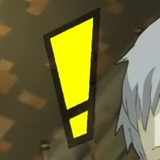
|02|Two exclamation marks|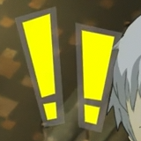
|03|Question mark|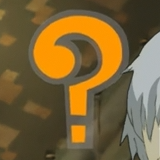
|04|Interrobang|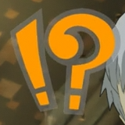
|05|Anger veins|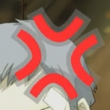
|06|Flowers|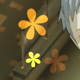
|07|Music note|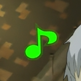
|08|Impact?|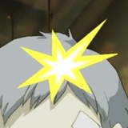
|09|Frusturation dust cloud|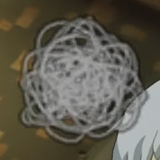
|10|Blush|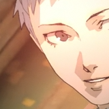
|11|Speaking lines?|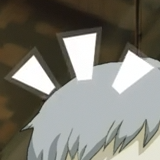
|12|Annoyed lightning bolts?|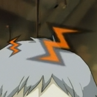
|13|Heart|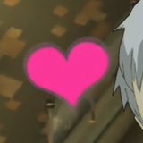
|14|Sleeping Z's|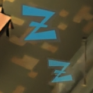
|15|PiPiPi phone ringing|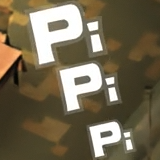
|16|Two sweatdrops, one big one small|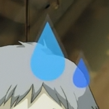
|17|Four sweatdrops|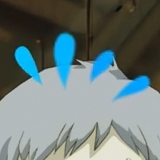
|18|White spiked bubble thing?|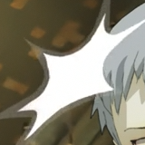
|19|Music note with particles|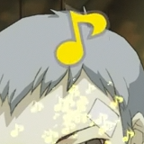
|20|Two music notes with particles|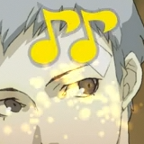
|21|Three music notes with particles|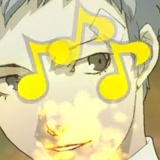
|22|Green music note with particles|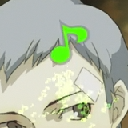

To add one to a message, add `[f 6 1 1 0 x y]` into your message, where `x` equals the character id you want to play the icon over, and `y` is the id of the icon you want to play.

As an example:
```
[s][bup 6 1 3 1][f 6 1 1 0 6 3]Huh?[w][e]
```
Would result in a message box using Fuuka's winter outfit "default" emotion bustup playing expression `3` on it.